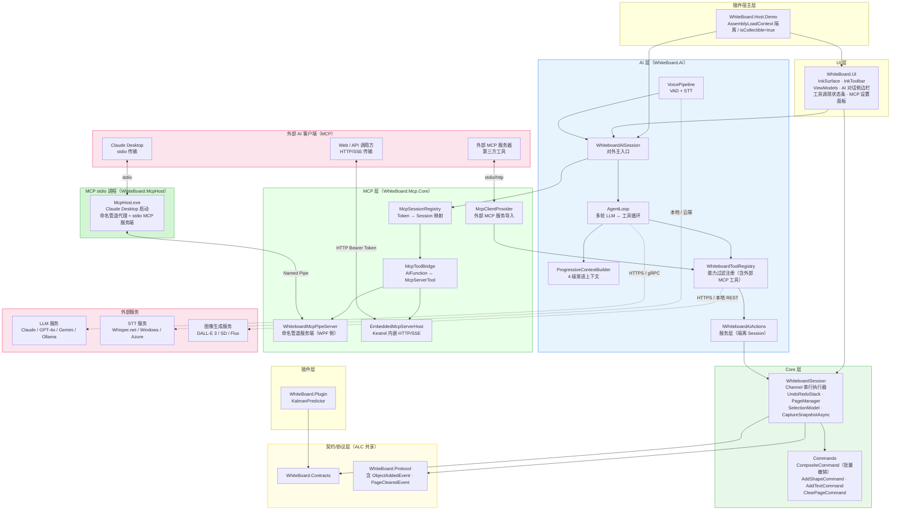

# AI 智能白板完整设计计划
> 整合自：产品头脑风暴 + VeloxDev 参考分析 + Codex 架构评审 + MCP 集成设计（2026-06-12）
> 原始计划文件：ai-whiteboard-design.md（Phases A-G）+ mcp-integration.md（Phases H-I）
> Codex SESSION_ID（AI 架构）: 019eb975-e4f3-7f52-877e-86829bf2a89a
> Codex SESSION_ID（MCP 集成）: 019eba63-fbe8-73e3-bec9-67d474ed5eec
> 前置文档: whiteboard-plugin-architecture.md（基础白板插件架构）

---

## 架构总览图



---

## 一、产品愿景

将白板打造为 **AI 智能白板**：用户可通过文字对话或语音与 AI 交互，AI 自动调用白板所有功能，实现自然语言驱动的内容创作；同时支持将白板工具暴露给外部 AI 客户端（Claude Desktop 等），也支持从外部 MCP 服务器导入工具扩展能力。

### 1.1 核心场景

| 场景类型 | 示例 | 技术路径 |
|---------|------|---------|
| **基础控制** | "撤销"、"清空白板"、"新建一页" | AI 调用 undo/clear/add_page 工具 |
| **绘图控制** | "在中间画一个红色圆形" | AI 计算坐标 → insert_shape 工具 |
| **流程图生成** | "帮我画一个用户登录流程图" | AI 规划节点 → 批量 insert_shape + insert_line |
| **AI 生图插入** | "帮我画一只在会议室开会的企鹅" | 图像模型生成 → insert_image 工具 |
| **教育解题** | "解一下 2x²-5x+3=0" | LLM 解题 → render_latex 逐步写到白板 |
| **外部 AI 控制白板** | Claude Desktop 发出指令操作白板 | MCP stdio → McpHost → Named Pipe → 白板工具 |
| **外部 MCP 工具扩展** | 白板 AI 调用外部 MCP 服务器（如搜索、代码执行） | McpClientProvider → 导入为 AIFunction |

### 1.2 设计决策（已确认）

| 决策点 | 选择 |
|--------|------|
| LLM 支持范围 | 在线（Claude/GPT/Gemini）+ 离线（Ollama/本地部署） |
| MCP Server 传输 | stdio（Claude Desktop）+ HTTP/SSE（Web/远程） |
| MCP Session 绑定 | Bearer Token → `McpSessionRegistry` → `WhiteboardAISession` 弱引用 |
| MCP 安全默认 | 破坏性工具默认关闭（`AllowDestructiveTools = false`） |
| 上下文策略 | 渐进式（4 级），AI 主动请求更多上下文 |
| 执行模式 | Auto（全自动）和 ConfirmRequired（破坏性操作需确认） |
| API Key 存储 | Windows Credential Manager（DPAPI 保护） |

---

## 二、项目结构

```
src/
├── WhiteBoard.Contracts/          (已有，需补充接口)
├── WhiteBoard.Protocol/           (已有，需补充事件类型)
├── WhiteBoard.Core/               (已有，需补充基础件)
├── WhiteBoard.UI/                 (已有，需补充 MCP 设置面板)
├── WhiteBoard.Plugin/             (已有)
├── WhiteBoard.Host.Demo/          (已有)
├── WhiteBoard.AI/                 (已实施 Phases B-G 骨架)
│   ├── Abstractions/              ← LLM/STT/TTS/ImageGen/Math 抽象
│   ├── Providers/                 ← 各提供商实现
│   ├── Services/                  ← IWhiteboardAiActions
│   ├── Session/                   ← WhiteboardAISession · AgentLoop · 上下文管理
│   ├── Tools/                     ← 工具注册表 + 各 Catalog
│   ├── Voice/                     ← VoicePipeline
│   ├── Math/                      ← WpfMathRenderer
│   └── Settings/                  ← AIWhiteboardSettings（含 McpServer/McpClient）
├── WhiteBoard.Mcp.Core/           (Phase H，已实施)
│   ├── Registry/                  ← McpSessionRegistry · Token 管理
│   ├── Server/                    ← McpToolBridge · WhiteboardMcpServerTool
│   ├── IPC/                       ← PipeContract · PipeServer · PipeClient
│   ├── Hosting/                   ← EmbeddedMcpServerHost · McpTokenAuthHandler
│   └── Client/                    ← McpClientProvider · ExternalMcpConnectionSpec
└── WhiteBoard.McpHost/            (Phase H，已实施)
    ├── Program.cs                 ← stdio MCP 主机 + 命名管道代理
    └── McpPipeBackedAiFunction.cs ← AIFunction → 管道调用代理
```

---

## 三、关键接口设计

### 3.1 LLM 无关抽象

```csharp
public interface ILlmProvider
{
    string ProviderName { get; }
    bool   IsAvailable  { get; }
    IChatClient CreateClient();   // Microsoft.Extensions.AI
}
```

### 3.2 AI 操作服务层

```csharp
public interface IWhiteboardAiActions
{
    Task<ToolResult> InsertShapeAsync(ShapeSpec spec, string? alias = null, CancellationToken ct = default);
    Task<ToolResult> InsertTextAsync(TextSpec spec, string? alias = null, CancellationToken ct = default);
    Task<ToolResult> InsertImageAsync(ImageSpec spec, string? alias = null, CancellationToken ct = default);
    Task<ToolResult> MoveObjectsAsync(IReadOnlyList<string> aliases, float dx, float dy, CancellationToken ct = default);
    Task<ToolResult> DeleteObjectsAsync(IReadOnlyList<string> aliases, CancellationToken ct = default);
    Task<ToolResult> ClearPageAsync(CancellationToken ct = default);
    Task<ToolResult> UndoAsync(string? groupId = null, CancellationToken ct = default);
    Task<ToolResult> RedoAsync(CancellationToken ct = default);
    Task<PageSnapshot> GetSnapshotAsync(CancellationToken ct = default);
    Task<ToolResult> SelectObjectsAsync(float x, float y, float w, float h, CancellationToken ct = default);
}
```

### 3.3 工具结果契约

```csharp
public sealed record ToolResult(
    string                          Status,          // "ok" | "error" | "confirm_required"
    string?                         ErrorMessage,
    IReadOnlyList<string>           CreatedObjectIds,
    Dictionary<string, string>      Aliases,         // { "triangle_a": "guid-1" }
    string?                         UndoGroupId,
    string?                         PageId,
    long                            PageVersion,
    IReadOnlyList<string>           Warnings
);
```

### 3.4 MCP Session 注册表

```csharp
public interface IMcpSessionRegistry
{
    Task<McpTokenDescriptor> CreateTokenAsync(WhiteboardAISession session, McpTokenPolicy policy, CancellationToken ct = default);
    Task<McpSessionBinding?> ResolveAsync(string token, string transport, CancellationToken ct = default);
    Task RevokeAsync(string token, CancellationToken ct = default);
    IReadOnlyList<McpSessionBinding> ActiveBindings { get; }
    event EventHandler<McpSessionBinding> ConnectionOpened;
    event EventHandler<McpSessionBinding> ConnectionClosed;
}

public sealed record McpTokenPolicy(TimeSpan Lifetime, bool AllowDestructiveTools, IReadOnlySet<string> AllowedTransports);
```

### 3.5 MCP 数据流（stdio 路径）

```
Claude Desktop
    → 启动 WhiteBoard.McpHost.exe（携带 WHITEBOARD_MCP_TOKEN 环境变量）
    → McpHost 连接 WPF 进程命名管道 "whiteboard-mcp"
    → McpHost 列出工具（通过管道 → WPF 侧 McpSessionRegistry 验证 Token → McpToolBridge.ExportTools）
    → McpHost 以 WhiteboardMcpServerTool 包装，启动 stdio MCP 服务端
    → Claude Desktop 调用工具 → McpHost 通过管道转发 → WPF 侧 WhiteboardToolRegistry.InvokeAsync
```

### 3.6 MCP 数据流（HTTP 路径）

```
外部客户端
    → HTTP POST /mcp + Authorization: Bearer <token>
    → EmbeddedMcpServerHost（Kestrel 内嵌）
    → McpTokenAuthHandler 验证 Token
    → ConfigureSessionOptions 注入 WhiteboardMcpServerTool 到会话工具集
    → 工具调用 → WhiteboardMcpServerTool.InvokeAsync → WhiteboardToolRegistry
```

---

## 四、渐进式上下文（4 级）

```
Level 0（始终注入 system prompt）：工具列表 + 当前页码 + 执行模式
Level 1（AI 调用 get_current_tool）：详细工具状态、视口、撤销可用性
Level 2（AI 调用 list_objects）：对象摘要列表（非完整 JSON）
Level 2.5（AI 调用 get_object_details(id)）：单对象完整信息
Level 3（AI 调用 get_ocr_text，昂贵）：手写 OCR 结果
```

---

## 五、完整工具清单

### 白板内置工具（始终可用）

| 目录 | 工具 | 破坏性 |
|------|------|--------|
| **Drawing** | draw_stroke, insert_shape, set_pen_color/thickness/type | — |
| **Editing** | undo, redo, select_objects, select_all, move_selected | — |
| **Editing** | clear_page, delete_selected, delete_objects | ✅ |
| **Content** | insert_text, insert_image | — |
| **Query** | get_canvas_size, get_current_tool, list_objects, get_object_details, get_ocr_text | — |
| **Navigation** | add_page, navigate_page, get_page_count, zoom_in/out, reset_view | — |

### 条件工具

| 条件 | 工具 |
|------|------|
| `IImageGenProvider.IsAvailable` | generate_and_insert_image |
| `IMathRenderer` 已配置 | render_latex, solve_and_show, draw_chart |
| 外部 MCP 服务器已连接 | `{prefix}__{外部工具名}` |

---

## 六、WhiteBoard.Core 必须补充的基础件

> [CRITICAL] 必须在 WhiteBoard.AI 实施前完成

- [ ] `CompositeCommand`（批量撤销组，含 GroupId）
- [ ] `AddShapeCommand`、`AddTextCommand`、`ClearPageCommand`
- [ ] `ShapeObject` + `ObjectKind.Shape = 7`
- [ ] `SelectionModel`（Core 层稳定选择集合）
- [ ] `Session.CaptureSnapshotAsync`（线程安全快照）
- [ ] 补全协同事件：`ObjectAddedEvent`、`ObjectsTransformedEvent`、`PageClearedEvent`
- [ ] 补全 `ApplyRemoteEvent` 对所有新事件的处理

---

## 七、实施阶段规划

### Phase A：Core 基础件补全 ✅ 已实施（扫描确认全部存在）

- [x] CompositeCommand（批量撤销）
- [x] AddShapeCommand、AddTextCommand、ClearPageCommand
- [x] ShapeObject + ObjectKind.Shape = 7
- [x] SelectionModel
- [x] CaptureSnapshotAsync
- [x] 协同事件补全 + ApplyRemoteEvent 补全

### Phase B：WhiteBoard.AI 骨架 ✅ 已实施（完整）

- [x] 创建 WhiteBoard.AI 项目
- [x] IWhiteboardAiActions + WhiteboardAiActionsImpl（含导航方法）
- [x] AgentLoop（多轮工具调用循环，含 ToolResultEnvelope 归一化）
- [x] WhiteboardToolRegistry（能力过滤 + 外部工具注册 + 视口控制注册）
- [x] ProgressiveContextBuilder（Level 0-2）
- [x] AIWhiteboardSettings + McpServer/McpClient 设置
- [x] ISecretStore + WindowsCredentialStore（Windows Credential Manager）

### Phase C：核心工具集 ✅ 已实施（完整）

- [x] DrawingToolCatalog
- [x] EditingToolCatalog
- [x] QueryToolCatalog
- [x] NavigationToolCatalog（add_page / navigate_page / get_page_count + 视口控制钩子）
- [x] ContentToolCatalog

### Phase D：LLM 多提供商接入 ✅ 已实施

- [x] LlmProviderFactory（ollama / openai / anthropic / azure / custom 五种提供商）
- [x] SettingsBackedLlmProvider（ILlmProvider 适配器，包装 LlmProviderFactory）
- > 注：直接通过 LlmProviderFactory + SettingsBackedLlmProvider 统一覆盖所有提供商，
- > 无需为每种提供商单独实现类。

### Phase E：UI 集成 ✅ 已实施（完整）

- [x] AiChatViewModel（对话侧边栏 + 工具调用状态条 + MCP 活动指示器）
- [x] AiSettingsViewModel（LLM / MCP Server / MCP Client 设置面板）
- [x] AiChatView.xaml（消息气泡列表 + PTT 按钮 + 状态条 + 确认对话框）
- [x] AiSettingsView.xaml（LLM/语音/MCP Server/MCP Client 全量配置面板）
- [x] InverseBoolToVisibilityConverter + InverseBoolConverter（Views 层复用转换器）

### Phase F：语音管道 ✅ 已实施（完整）

- [x] VoicePipeline（VAD + STT，Push-to-Talk 默认）
- [x] WhisperNetProvider（本地离线 STT，子进程隔离）
- [x] WindowsSpeechProvider（零依赖 fallback，System.Speech）
- [x] VoiceProviderFactory + WindowsTtsProvider
- [x] WakeWordDetector（IWakeWordDetector 接口 + WindowsSpeechWakeWordDetector 实现）

### Phase G：扩展能力 ✅ 已实施（骨架）

- [x] IImageGenProvider + DallE3Provider / StableDiffusionProvider
- [x] ImageGenToolCatalog（generate_and_insert_image 工具）
- [x] IMathRenderer + WpfMathRenderer + MathStepWriter
- [x] MathToolCatalog（render_latex / solve_and_show / draw_chart）

### Phase H：MCP Server ✅ 已实施

- [x] **H1** WhiteBoard.Mcp.Core 项目骨架（含 GlobalUsings，net10.0-windows）
- [x] **H1** McpSessionRegistry（Token 生命周期管理，SHA-256 哈希，弱引用 Session）
- [x] **H2** WhiteboardMcpServerTool（`McpServerTool` 子类替代内部 `AIFunctionMcpServerTool`）
- [x] **H2** McpToolBridge（能力过滤 → WhiteboardMcpServerTool 导出）
- [x] **H3** PipeContract（NDJSON 消息契约）
- [x] **H3** WhiteboardMcpPipeServer（WPF 侧命名管道服务端）
- [x] **H3** WhiteboardMcpPipeClient（McpHost 侧管道客户端）
- [x] **H3** WhiteBoard.McpHost 项目（net10.0-windows，McpPipeBackedAiFunction）
- [x] **H4** EmbeddedMcpServerHost（Kestrel 内嵌 + per-session ToolCollection）
- [x] **H4** McpTokenAuthHandler（Bearer Token 认证中间件）
- [x] **H5** AIWhiteboardSettings 扩展（McpServer + McpClient 配置块）
- [x] **H6** WhiteboardAISession.McpTokenIssued 事件 + RegisterExternalTools
- [x] **H6** WhiteboardAISession.IssueMcpTokenAsync / RevokeMcpTokenAsync + SetMcpTokenFactory（IMcpTokenFactory 接口打破循环依赖）
- [x] **H7** AiSettingsViewModel MCP Server 面板属性 + ClaudeDesktopConfigSnippet
- [x] **H7** AiChatViewModel MCP 活动指示器（McpActiveConnections / HasMcpActivity）

### Phase I：MCP Client ✅ 已实施（骨架）

- [x] **I1** McpClientProvider（外部 MCP 服务 stdio/http 连接 + 工具列表导入）
- [x] **I2** WhiteboardToolRegistry.RegisterExternalTools / GetFunctions / InvokeAsync
- [x] **I3** AgentLoop ToolResultEnvelope.Normalize（string/ToolResult/object 统一序列化）
- [x] **I4** AiSettingsViewModel McpConnections + Add/Remove 命令
- [x] **I4** McpClientConnectionItemViewModel

---

## 八、遗留问题 & 下一步

所有计划项已全部完成（Phases A–I + F WakeWord）。

### Phase E Host.Demo 集成 ✅ 已实施（2026-06-12）

**关键改动**：
- `WhiteboardPluginContext.SharedAssemblies` 新增 `WhiteBoard.Core`、`WhiteBoard.UI`、`WhiteBoard.AI` — 使插件与宿主共享同一类型标识，`as WhiteboardSession` 转型安全
- `PluginManager.GetExportedSession()` — 通过反射获取插件私有 `_session` 字段，返回 `WhiteboardSession?`
- `WhiteBoard.Host.Demo.csproj` — 新增 `WhiteBoard.UI` ProjectReference（传递引入 Core + AI）
- `MainWindow.xaml` — Grid 双列布局：左侧插件区域 + 右侧 320px AI 侧边栏（`ColAi` ColumnDefinition，初始 Width=0）
- `MainWindow.xaml.cs` — 插件加载后自动创建 `SettingsBackedLlmProvider` + `WhiteboardAISession` + `AiChatViewModel`；`EnvSecretStore` 从环境变量读取 API Key（WHITEBOARD_LLM_PROVIDER / ENDPOINT / MODEL）
- ToggleButton "🤖 AI" 控制侧边栏显示/隐藏（Checked/Unchecked → ColAi.Width 切换）

---

## 九、已知技术决策与偏差记录

### 与原计划的偏差

| 项目 | 计划 | 实际实施 | 影响 |
|------|------|---------|------|
| `McpTokenIssued` 事件签名 | `EventHandler<McpTokenDescriptor>` | `EventHandler<string>`（仅 token 字符串）| 轻微，UI 获取不到过期时间 |
| `McpServerTool` 创建方式 | `McpServerTool.Create(AIFunction, ...)` | 自定义 `WhiteboardMcpServerTool : McpServerTool` 子类 | 因 SDK 内部类限制改用子类，功能等价 |
| `McpClient.CreateAsync` 返回类型 | `IMcpClient`（接口）| `McpClient`（具体类，SDK 1.4.0 无此接口） | 无外部影响 |
| `CallToolResponse` | — | 实际为 `CallToolResult`，`Content` 为 `IList<ContentBlock>` | SDK 命名与文档不一致，已修正 |
| `McpServerTool.InvokeAsync` 返回类型 | `Task<>` | `ValueTask<>` | SDK 要求，已修正 |

### 技术决策记录（ADR）

| 编号 | 决策 | 原因 |
|------|------|------|
| ADR-023 | Microsoft.Extensions.AI 作为 LLM 抽象层 | LLM 无关，一行切换 |
| ADR-024 | 渐进式上下文（4 级） | 避免 token 浪费 |
| ADR-025 | IWhiteboardAiActions 服务层隔离 | AgentLoop 不直接操作 Session |
| ADR-026 | CompositeCommand 批量撤销 | AI 多步操作必须整体撤销 |
| ADR-027 | SelectionModel 在 Core 层 | AI 不依赖 ViewModel 瞬态状态 |
| ADR-028 | PageSnapshot 不可变副本 | 跨线程安全读取 Session 状态 |
| ADR-029 | Whisper.net 子进程隔离 | Native DLL 阻止 ALC.Unload() |
| ADR-030 | Windows Credential Manager 存密钥 | DPAPI 保护 |
| ADR-035 | WhiteboardMcpServerTool 自定义子类 | SDK 1.4.0 `AIFunctionMcpServerTool` 为 internal |
| ADR-036 | McpHost 目标 net10.0-windows | 依赖链需匹配 WhiteBoard.Mcp.Core（UseWPF=true） |
| ADR-037 | McpHost 不持有 Session，通过管道代理 | 避免跨进程 Session 引用复杂度 |
| ADR-038 | Core/UI/AI 加入 ALC SharedAssemblies | 宿主需直接持有 WhiteboardSession 引用；共享后 as 转型安全，无 InvalidCastException |
| ADR-039 | PluginManager 用反射暴露 `_session` | 不改 Contracts 接口；Demo 场景一次性反射开销可接受 |
| ADR-040 | EnvSecretStore 代替 WindowsCredentialStore（Demo） | Demo 无需配置 Credential Manager，env var 即可切换 LLM |
| ADR-041 | IMcpTokenFactory 接口定义在 WhiteBoard.AI.Abstractions | 打破 AI ↔ Mcp.Core 循环依赖；Mcp.Core 实现 McpSessionRegistryTokenFactory 后通过 SetMcpTokenFactory 注入 |

---

## 十、Claude Desktop 接入示例

```json
{
  "mcpServers": {
    "whiteboard": {
      "command": "C:\\Path\\To\\WhiteBoard.McpHost.exe",
      "env": {
        "WHITEBOARD_MCP_TOKEN": "<从白板设置页面复制>",
        "WHITEBOARD_MCP_PIPE_NAME": "whiteboard-mcp"
      }
    }
  }
}
```

---

## 十一、使用示例

### 11.1 Host.Demo 快速启动

```bash
# 最小化配置：使用本地 Ollama
set WHITEBOARD_LLM_PROVIDER=ollama
set WHITEBOARD_LLM_ENDPOINT=http://localhost:11434
set WHITEBOARD_LLM_MODEL=qwen2.5

# 使用 OpenAI
set WHITEBOARD_LLM_PROVIDER=openai
set WHITEBOARD_LLM_MODEL=gpt-4o
set WHITEBOARD_LLM_APIKEY_REF=sk-...   # 或通过 Windows Credential Manager

# 使用 Anthropic Claude
set WHITEBOARD_LLM_PROVIDER=anthropic
set WHITEBOARD_LLM_MODEL=claude-opus-4-7
set WHITEBOARD_LLM_APIKEY_REF=sk-ant-...
```

启动后点击主窗口右上角 **🤖 AI** 按钮展开/折叠 AI 侧边栏。

---

### 11.2 在代码中构建 WhiteboardAISession

```csharp
// ① 准备 LLM Provider
var settings = new AIWhiteboardSettings
{
    LlmProviderType = "anthropic",
    LlmModel        = "claude-opus-4-7",
    LlmApiKeyRef    = "my-anthropic-key",   // Windows Credential Manager 中的键名
    ExecutionMode   = "ConfirmRequired",
};
ISecretStore secrets = new WindowsCredentialStore();
ILlmProvider llmProvider = new SettingsBackedLlmProvider(settings, secrets);

// ② 创建 Session
WhiteboardSession whiteboardSession = /* 从插件或 Core 层获取 */;
var aiSession = new WhiteboardAISession(llmProvider, whiteboardSession);

// ③ 连接 UI（可选）
var chatVm = new AiChatViewModel(aiSession);
AiPanel.DataContext = chatVm;

// ④ 发送消息（流式）
await foreach (var evt in aiSession.SendMessageAsync("在白板中间画一个红色圆形"))
{
    // evt: AgentLoopEvent（TextChunk / ToolCall / ToolResult / Done）
}

// ⑤ 释放资源
await aiSession.DisposeAsync();
```

---

### 11.3 Push-to-Talk 语音输入

```csharp
// 创建 STT Provider（Whisper 本地离线）
ISttProvider stt = VoiceProviderFactory.CreateStt(settings, secrets);

// 挂载语音管道（PTT 模式）
aiSession.AttachVoice(stt, language: "zh");

// UI 按钮按下 / 抬起
void OnPttButtonDown()  => aiSession.StartPtt();
async void OnPttButtonUp() => await aiSession.StopPttAsync();

// 语音转文字后自动触发 SendMessageAsync，无需手动调用
// 结果通过 VoiceTextReady 事件反馈到 UI（显示识别出的文字气泡）
aiSession.VoiceTextReady += (_, text) => Dispatcher.Invoke(() => chatVm.AddVoiceBubble(text));
```

---

### 11.4 Wake-Word 语音输入

```csharp
// Settings 配置
settings.VoiceMode                = "wake-word";
settings.WakeWordEnabled          = true;
settings.WakeWord                 = "嘿白板";       // 触发短语
settings.WakeWordProviderType     = "windows";      // System.Speech
settings.WakeWordUtteranceSeconds = 5;              // 检测到唤醒词后最多录音 5 秒

// 创建唤醒词检测器
IWakeWordDetector? wakeWord = VoiceProviderFactory.CreateWakeWordDetector(settings);

// 挂载（AttachVoice + wakeWordDetector → 自动后台监听）
aiSession.AttachVoice(
    stt:                stt,
    language:           "zh",
    wakeWordDetector:   wakeWord,
    utteranceTimeout:   TimeSpan.FromSeconds(settings.WakeWordUtteranceSeconds));

// 之后无需手动操作：
// 1. 用户说"嘿白板" → WakeWordDetected 触发
// 2. VoicePipeline 自动开始录音
// 3. 5 秒后停止，送入 STT 识别
// 4. 识别结果自动触发 SendMessageAsync

// 退出时清理
aiSession.DetachVoice();
```

---

### 11.5 MCP Server：签发 Token 并接入 Claude Desktop

```csharp
// ① 初始化 MCP 基础设施（应用启动时执行一次）
var registry = new McpSessionRegistry();
var pipeServer = new WhiteboardMcpPipeServer(registry);
await pipeServer.StartAsync();                     // 监听命名管道 "whiteboard-mcp"

// ② 将 Token 工厂注入 Session
var tokenFactory = new McpSessionRegistryTokenFactory(registry, aiSession);
aiSession.SetMcpTokenFactory(tokenFactory);

// ③ 签发 Token（有效期 60 分钟，禁止破坏性工具）
string token = await aiSession.IssueMcpTokenAsync(
    lifetime:        TimeSpan.FromMinutes(60),
    allowDestructive: false);

// token 同时触发 McpTokenIssued 事件，AiSettingsViewModel.CurrentMcpToken 自动更新
// UI 显示 ClaudeDesktopConfigSnippet 供用户复制

// ④ 吊销 Token（用户点击"重新生成"时先吊销旧 Token）
await aiSession.RevokeMcpTokenAsync();
```

---

### 11.6 MCP Client：导入外部 MCP 服务工具

```csharp
// ① 定义外部 MCP 连接（UI 中配置的等价代码形式）
var spec = new ExternalMcpConnectionSpec
{
    ConnectionId  = "search-mcp",
    DisplayName   = "Exa 搜索",
    Transport     = "stdio",
    Command       = "npx",
    Arguments     = ["-y", "exa-mcp-server"],
    ToolNamePrefix = "search",         // 工具名前缀：search__web_search
    TrustLevel    = "restricted",
    AllowDestructiveTools = false,
};

// ② 连接并导入工具
var provider = new McpClientProvider();
var registrations = await provider.GetToolRegistrationsAsync(spec);

// ③ 注册到 Session（之后 AgentLoop 可调用这些外部工具）
aiSession.RegisterExternalTools(registrations);

// 工具调用示例：AI 现在可在对话中自动调用 search__web_search
await foreach (var evt in aiSession.SendMessageAsync("搜索最新的量子计算进展并整理到白板"))
{ /* ... */ }
```

---

### 11.7 整合示例：完整初始化流程

```csharp
public async Task InitializeAiWhiteboardAsync(WhiteboardSession session)
{
    // LLM
    var settings = LoadSettingsFromDisk();   // 反序列化 AIWhiteboardSettings
    var secrets  = new WindowsCredentialStore();
    var llm      = new SettingsBackedLlmProvider(settings, secrets);

    // AI Session
    _aiSession = new WhiteboardAISession(llm, session,
        mode: Enum.Parse<ExecutionMode>(settings.ExecutionMode));

    // 语音（按配置选择 PTT 或 Wake-Word）
    if (settings.SttEnabled)
    {
        var stt      = VoiceProviderFactory.CreateStt(settings, secrets);
        var wakeWord = VoiceProviderFactory.CreateWakeWordDetector(settings);
        _aiSession.AttachVoice(stt, settings.SttLanguage, wakeWord,
            TimeSpan.FromSeconds(settings.WakeWordUtteranceSeconds));
    }

    // MCP Server
    if (settings.McpServer.Enabled)
    {
        var registry    = new McpSessionRegistry();
        var pipeServer  = new WhiteboardMcpPipeServer(registry);
        await pipeServer.StartAsync();

        if (settings.McpServer.HttpEnabled)
        {
            var httpHost = new EmbeddedMcpServerHost(registry,
                new Uri(settings.McpServer.HttpUrl));
            await httpHost.StartAsync();
        }

        _aiSession.SetMcpTokenFactory(
            new McpSessionRegistryTokenFactory(registry, _aiSession));
        await _aiSession.IssueMcpTokenAsync(
            TimeSpan.FromMinutes(settings.McpServer.TokenLifetimeMinutes),
            settings.McpServer.AllowDestructiveTools);
    }

    // MCP Client（外部工具导入）
    if (settings.McpClient.Enabled && settings.McpClient.Connections.Count > 0)
    {
        var provider = new McpClientProvider();
        foreach (var conn in settings.McpClient.Connections.Where(c => c.Enabled))
        {
            var spec = ExternalMcpConnectionSpec.From(conn);
            var tools = await provider.GetToolRegistrationsAsync(spec);
            _aiSession.RegisterExternalTools(tools);
        }
    }

    // UI 绑定
    _chatVm = new AiChatViewModel(_aiSession);
    AiPanel.DataContext = _chatVm;
}
```

---

## 十二、参考资源

- 基础白板插件架构：`whiteboard-plugin-architecture.md`（本目录）
- Codex AI 架构评审 Session：`019eb975-e4f3-7f52-877e-86829bf2a89a`
- Codex MCP 集成 Session：`019eba63-fbe8-73e3-bec9-67d474ed5eec`
- Microsoft.Extensions.AI：https://learn.microsoft.com/dotnet/ai/
- ModelContextProtocol C# SDK：https://github.com/modelcontextprotocol/csharp-sdk
